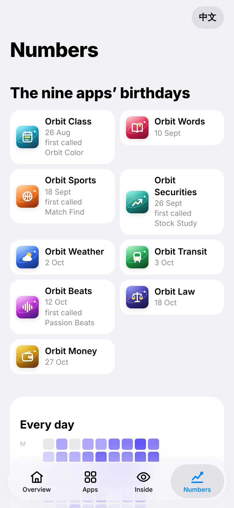

<p align="center">
  
</p>

<h1 align="center">Orbit Showcase</h1>

<p align="center">
  <b>Orbit explained for anyone.</b><br>
  <a href="https://jaypengx.com/showcase/"><b>jaypengx.com/showcase</b></a>
</p>

<p align="center">
     
</p>

The Orbit family of apps, shown the way a page does better than a PDF: the structure, the numbers, and the apps themselves running. Open to everyone, on phones and computers, with no sign-in.

<p align="center">
  
  
</p>

## Features

| Tab | What you see |
| --- | --- |
| 總覽 Overview | The family of apps and the headline numbers |
| App | Each app's screens, the question it answers (problem, idea, result), and the app itself running on sample data with a guided tour |
| 架構 Inside | How it's built, as small pictures first (steps, numbers, before and after), technical names folded away |
| 數字 Numbers | When each app arrived, every day's updates, the hours of the day, and code written and rewritten |

- **For readers who know no tech:** plain everyday words, Chinese first and English second.
- **Open to everyone:** no sign-in and no install step; a real desktop layout as well as the phone one, in Safari and Chrome.
- **Real apps, frozen:** each demo is the app's own code recorded on made-up data at a fixed clock, so it runs the same every time without touching anyone's account.

## Tech stack

| Layer | What |
| --- | --- |
| Site | Plain JavaScript (ES modules), HTML and CSS; no framework, no build step |
| Look | The kit in [Shared-Proxy](https://github.com/JayPengX/Shared-Proxy) plus `showcase.css` |
| Numbers | `scripts/stats.mjs` counts commits, lines, tests and days from every Orbit repo's git history |
| Demos | Recorded with Playwright through Shared-Proxy's preview tool, then frozen into `public/demo/` |
| Hosting | GitHub Pages, served at jaypengx.com by a Cloudflare Worker |
| Tests | `node --test` (`tests/content.test.mjs` checks the content rules) |

## How it works

```
GitHub Actions, every push and daily at 00:17 Taipei
  clone every Orbit repo ─► scripts/stats.mjs ─► public/data/stats.json
  npm test ─► stamp versions ─► GitHub Pages

scripts/demo/record.mjs <app>   the app served with made-up answers, its tour walked,
                                every answer it got kept
scripts/demo/build.mjs          the recording frozen into public/demo/<Repo>/
```

- **Every number comes from git**, recounted daily; nothing on the pages is typed in.
- **Sample data only:** the demos open on a made-up timetable and made-up books, never anyone's own.

Details: **[MAP.md](MAP.md)**.

## Project structure

```
public/
├── index.html, app.mjs, shell.mjs, showcase.css
├── views/               home, apps, demo, how (架構), numbers
├── lib/                 apps, demos, the structure tree, stories, births
├── data/stats.json      the numbers (written by the deploy)
├── demo/                each app frozen on sample data, with the kit it used
└── shots/               the apps' screenshots
scripts/
├── stats.mjs            the numbers, from git
└── demo/                record, build, and the made-up data they use
tests/                   node --test
MAP.md                   how it works
```

## Getting started

```bash
git clone https://github.com/JayPengX/Shared-Proxy.git
git clone https://github.com/JayPengX/Orbit-Showcase.git
cd Orbit-Showcase
npm test
```

Count the numbers yourself, with the family's repos cloned side by side:

```bash
TZ=Asia/Taipei node scripts/stats.mjs .. > public/data/stats.json
```

To preview, serve a folder that holds `Orbit-Showcase` (pointing at `public/`) and `Shared-Proxy` side by side, then open `/Orbit-Showcase/`:

```bash
mkdir -p /tmp/site && ln -sfn "$PWD/public" /tmp/site/Orbit-Showcase && ln -sfn "$PWD/../Shared-Proxy" /tmp/site/Shared-Proxy
npx --yes http-server /tmp/site -p 8080 -c-1   # http://localhost:8080/Orbit-Showcase/
```

Record a demo again: `node scripts/demo/record.mjs <app>`, then `node scripts/demo/build.mjs`.

## Deploying

Push to `main`. GitHub Actions recounts the numbers, runs the tests, stamps every file with its content hash (so a phone downloads only what changed) and publishes `public/` to GitHub Pages; the site Worker serves it at its jaypengx.com address. It also runs daily. There are no pull requests or release branches.

## Part of Orbit

| App | What it is |
| --- | --- |
| [Orbit Sports](https://github.com/JayPengX/Orbit-Sports) | Every game you can watch in Taiwan, live |
| [Orbit Transit](https://github.com/JayPengX/Orbit-Transit) | Bus, train, metro and YouBike, planned and navigated |
| [Orbit Weather](https://github.com/JayPengX/Orbit-Weather) | One clear forecast, to the township |
| [Orbit Words](https://github.com/JayPengX/Orbit-Words) | English vocabulary that stays |
| [Orbit Securities](https://github.com/JayPengX/Orbit-Securities) | A Taiwan broker on play money |
| [Orbit Class](https://github.com/JayPengX/Orbit-Class) | Today's classes at a glance |
| [Orbit Beats](https://github.com/JayPengX/Orbit-Beats) | Endless music and your own beats |
| [Orbit Law](https://github.com/JayPengX/Orbit-Law) | Laws, rulings and bills, linked |
| [Orbit Money](https://github.com/JayPengX/Orbit-Money) | Your own books |
| [Shared-Proxy](https://github.com/JayPengX/Shared-Proxy) | The kit, the Orbit Pass and the Workers behind them all |

How it was all built, in pictures and numbers: [jaypengx.com/showcase](https://jaypengx.com/showcase/).
